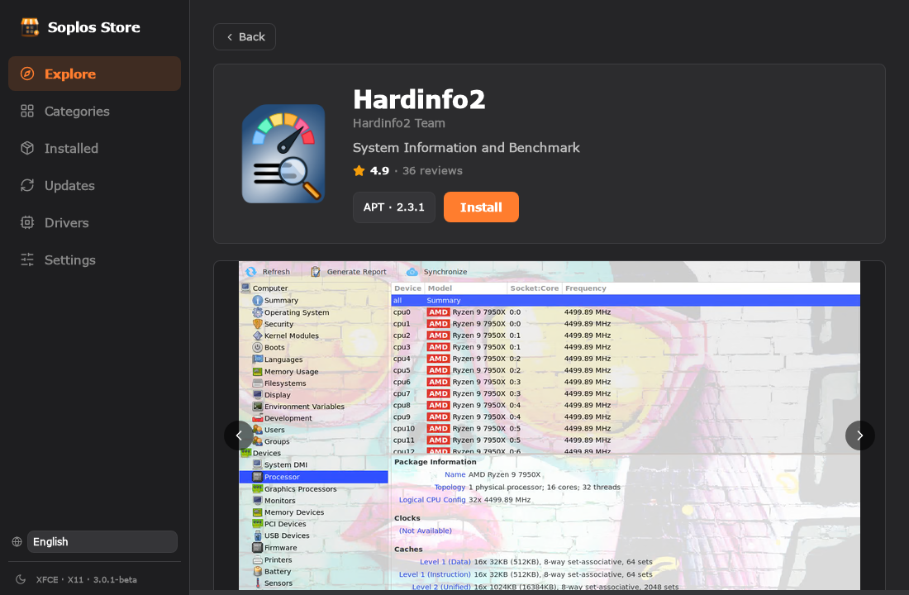
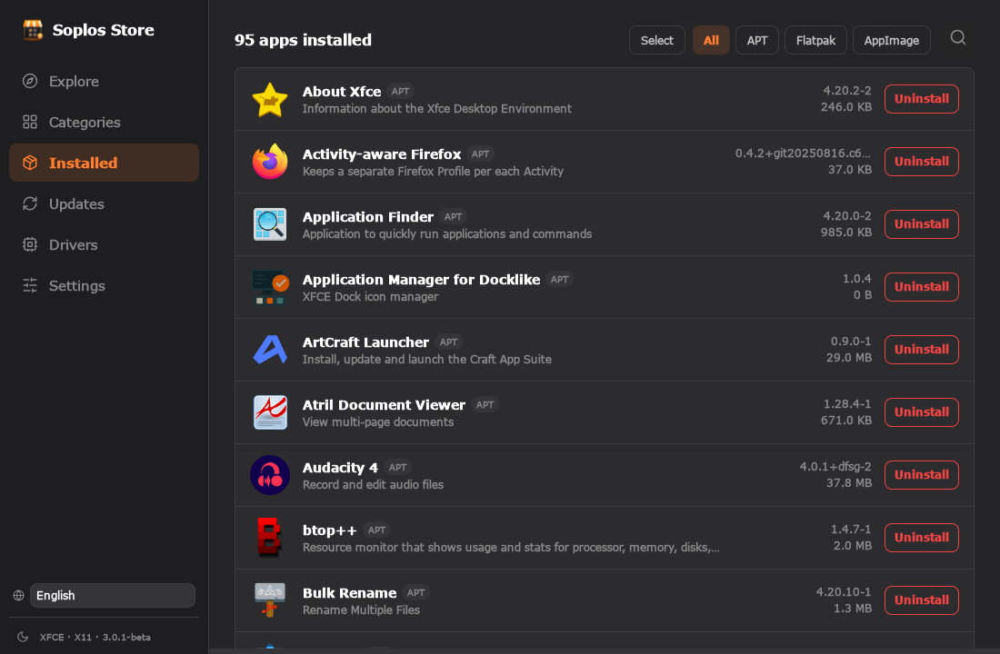
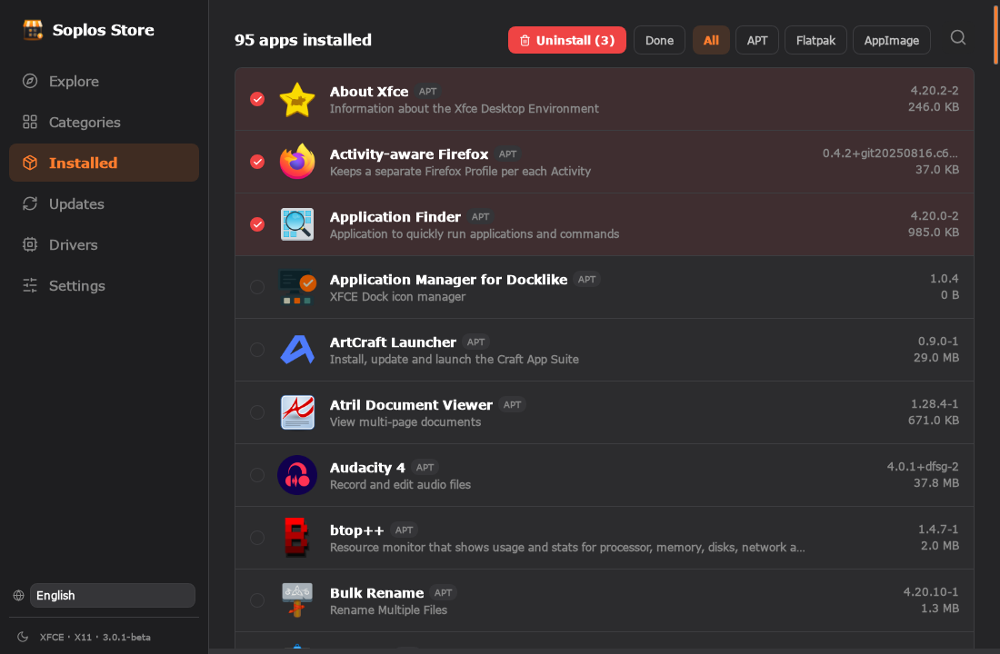
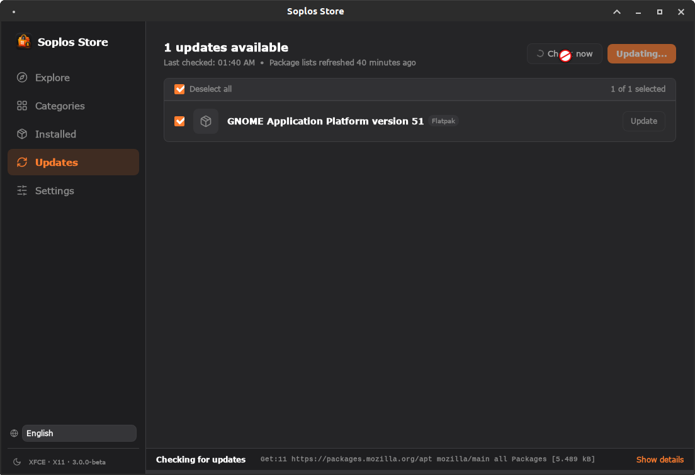
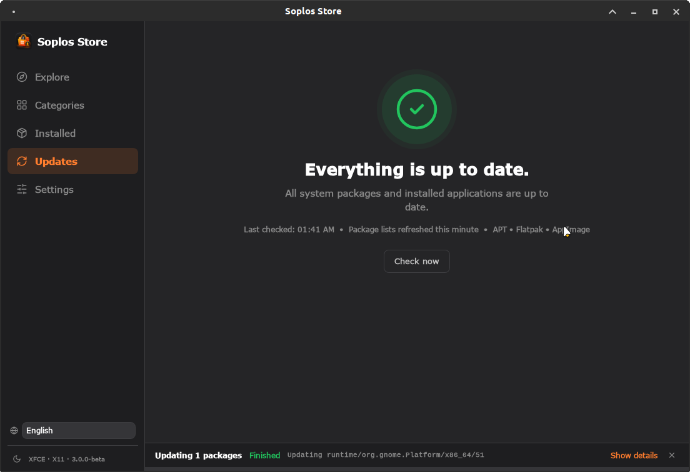
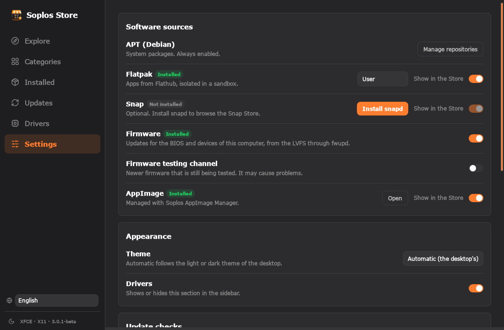

# Soplos Store 3.0


Software store for Soplos Linux.

It finds, installs, updates and removes applications from APT, Flatpak, Snap and AppImages in one place, and applies firmware updates through fwupd. What it shows comes from public databases, not from a list of its own: Debian's AppStream metadata, Flathub and the Snap Store, with ratings from ODRS.

## Screenshots

| | |
|---|---|
|  **Explore**: a carousel of highlighted apps for each section |  **App page**: screenshots, ratings, details and links |
|  **Categories**: complete catalog by software category |  **Category page**: subcategories, top rated apps and filters |
|  **Installed**: manage and search installed apps across sources |  **Batch uninstall**: select multiple installed apps for bulk removal |
|  **Updates**: pending updates with real-time progress logging |  **Up to date**: clean unified view when all packages are up to date |
|  **Settings**: sources, update checks and maintenance | |

## Architecture

Tauri 2 with a Rust backend and a Svelte 4 + Tailwind CSS frontend, rendered through the system's WebKitGTK, like the other Soplos 3.0 apps.

- **Backend** (`src-tauri/src/`): one module per source (`apt.rs`, `flathub.rs`, `flatpak.rs`, `snap.rs`, `appimage.rs`), `desktop.rs` for desktop entry discovery, `odrs.rs` for ratings, `catalog.rs` that merges them into one card per app, `jobs.rs` for install, remove and update jobs, `privileged.rs` for what runs as root, and `tray.rs` for the update notifier.
- **Frontend** (`src/`): one Svelte view per section, shared components, and the 8-language dictionaries under `src/i18n/`.
- **Privileges:** the window never runs as root. APT operations run through `pkexec` with two Polkit actions: `--privileged-refresh` for passwordless repository synchronization (`allow_active: yes`), and `--privileged <action>` for package changes (install, remove, upgrade), which prompts for administrator authentication and validates every package name. Commands are always built as argument lists, never as a shell string.
- **Cache:** `~/.cache/soplos-store/`. The app shows the last saved data when there is no network.

## Installation

```bash
sudo apt install soplos-store
```

## Sections

- **Explore:** a carousel of highlighted apps per section and the other apps below it, and a search across Debian, Flathub and Snap.
- **Categories:** each category has its own page with a carousel, a source filter and sorting.
- **Installed:** what is installed from APT, Flatpak, Snap and AppImages, with multi-selection for bulk removal and unified suite views (e.g. LibreOffice).
- **Updates:** pending updates, one by one or all at once, with a permanent toolbar, select-all control, and real-time status.
- **Drivers:** your graphics cards, each with the driver that fits it and its state, and the NVIDIA driver branches (550 from Debian, 580, 590 and 610 from NVIDIA's CUDA repository, and the legacy 470, 390 and 340 ones) as cards you install or remove with one confirmation. The installers carry the patches kernels 7.x need. AMD and Intel cards get their Mesa and firmware packages, and a hero that moves through every brand also offers the guest tools of VMware, QEMU/KVM and Proxmox, Virt-Manager and GNOME Boxes.
- **Settings:** software sources (with a switch for firmware updates and one for the firmware testing channel), install scope (asked only when Flathub is set up for both the user and the system), a switch to show or hide each source (Flatpak, Snap, AppImage), update checks, the sections of the home page and of the sidebar, and maintenance.

An app available from several sources appears once, with a selector on its page to choose where to install it. Flatpak and Snap only appear as sources when they are installed and turned on in Settings.

## Update notifier

The check is done by a systemd user timer (`soplos-store-updates.timer`, enabled for every user by the package) that runs `soplos-store --check-updates` starting 1 minute after boot and stores the result in `~/.cache/soplos-store/updates.json`, with the frequency chosen in Settings. `soplos-store --tray` starts with the session (`/etc/xdg/autostart/`) and when the app opens. It has no window: it shows the `software-update-available` tray icon and a desktop notification while there are updates across Xfce 4.20, KDE Plasma, and GNOME (via AppIndicator). Clicking either opens the app on Updates. It does not ask for a password or install anything by itself.

The package also sets `APT::Periodic::Update-Package-Lists` (`/etc/apt/apt.conf.d/20soplos-store`) so Debian's own timer refreshes the package lists daily.

## Package files

The desktop entry registers the app for `.deb`, `.flatpak`, `.flatpakref`, `.snap` and `.AppImage` files. All package formats can be installed directly from the app; `.AppImage` files are integrated into `~/AppImages` with their desktop launchers.

## Keyboard shortcuts

| Shortcut | Action |
|---|---|
| F1 | About |
| Ctrl+Q | Quit |
| Ctrl+Tab, Ctrl+Shift+Tab | Next or previous section |
| F5, Ctrl+R | Reload |
| Ctrl+F | Search |
| Escape, Alt+Left | Back |

## Documentation

A Unix manual page is included and installed with the package:

```bash
man soplos-store
```

Command line:

| Command | Action |
|---|---|
| `soplos-store` | Open the app |
| `soplos-store FILE` | Inspect and install a `.deb`, `.flatpak`, `.flatpakref`, `.snap` or `.AppImage` file |
| `soplos-store --updates` | Open directly on Updates |
| `soplos-store --tray` | Run as the update notifier, with no window |
| `soplos-store --check-updates` | Check for updates once and refresh the cache (used by the systemd timer) |

## Languages

English, Spanish, German, French, Italian, Portuguese, Romanian and Russian. It starts in the system language and falls back to English.

## Building

```bash
npm install
npm run tauri dev      # development
./package.sh           # builds the .deb and moves it to ~/Descargas/SoplosApps
```

## License

Copyright © 2026 Sergi Perich <info@soploslinux.com>. Published under the GPL-3.0-or-later license. See `LICENSE`.
