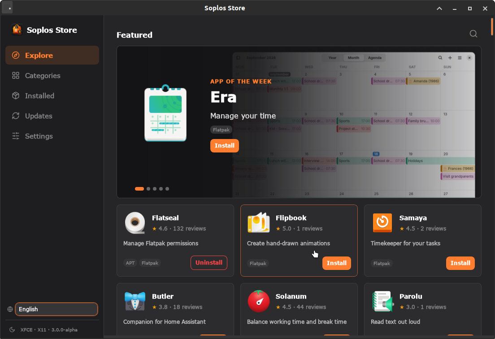
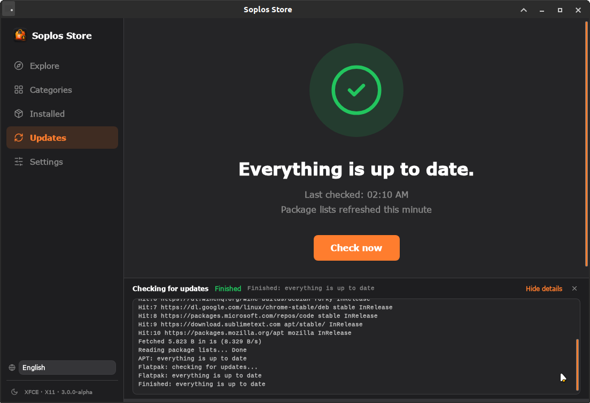

# Soplos Store 3.0

Software store for Soplos Linux.

It finds, installs, updates and removes applications from APT, Flatpak and Snap in one place. What it shows comes from public databases, not from a list of its own: Debian's AppStream metadata, Flathub and the Snap Store, with ratings from ODRS.

## Screenshots

| | |
|---|---|
|  Explore: a carousel of highlighted apps for each section |  Categories, each with its own page |
|  Installed apps from every source |  Updates, one by one or all at once |
|  Settings: sources, update checks and maintenance |  App page: screenshots, ratings, details and links |

## Architecture

Tauri 2 with a Rust backend and a Svelte 4 + Tailwind CSS frontend, rendered through the system's WebKitGTK, like the other Soplos 3.0 apps.

- **Backend** (`src-tauri/src/`): one module per source (`apt.rs`, `flathub.rs`, `flatpak.rs`, `snap.rs`), `odrs.rs` for ratings, `catalog.rs` that merges them into one card per app, `jobs.rs` for install, remove and update jobs, `privileged.rs` for what runs as root, and `tray.rs` for the update notifier.
- **Frontend** (`src/`): one Svelte view per section, shared components, and the 8-language dictionaries under `src/i18n/`.
- **Privileges:** the window never runs as root. APT operations start the same binary through `pkexec` with `--privileged <action>`, which accepts only a fixed set of actions and validates every package name. Commands are always built as argument lists, never as a shell string.
- **Cache:** `~/.cache/soplos-store/`. The app shows the last saved data when there is no network.

## Sections

- **Explore:** a carousel of highlighted apps per section and the other apps below it, and a search across Debian, Flathub and Snap.
- **Categories:** each category has its own page with a carousel, a source filter and sorting.
- **Installed:** what is installed from APT, Flatpak and Snap.
- **Updates:** pending updates, one by one or all at once.
- **Settings:** software sources, install scope, preferred source, update checks, recommendations and maintenance.

An app available from several sources appears once, with a selector on its page to choose where to install it. Flatpak and Snap only appear as sources when they are installed.

## Update notifier

The check is done by a systemd user timer (`soplos-store-updates.timer`, enabled for every user by the package) that runs `soplos-store --check-updates` and stores the result in `~/.cache/soplos-store/updates.json`, with the frequency chosen in Settings. `soplos-store --tray` starts with the session (`/etc/xdg/autostart/`) and when the app opens. It has no window: it shows a tray icon and a desktop notification while there are updates. Clicking either opens the app on Updates. It does not ask for a password or install anything by itself.

The package also sets `APT::Periodic::Update-Package-Lists` (`/etc/apt/apt.conf.d/20soplos-store`) so Debian's own timer refreshes the package lists daily.

## Package files

The desktop entry registers the app for `.deb`, `.flatpak`, `.flatpakref`, `.snap` and `.AppImage` files. The first four open on a page where they can be installed. AppImages are handed to Soplos AppImage Manager.

## Keyboard shortcuts

| Shortcut | Action |
|---|---|
| F1 | About |
| Ctrl+Q | Quit |
| Ctrl+Tab, Ctrl+Shift+Tab | Next or previous section |
| F5, Ctrl+R | Reload |
| Ctrl+F | Search |
| Escape, Alt+Left | Back |

## Languages

English, Spanish, German, French, Italian, Portuguese, Romanian and Russian. It starts in the system language and falls back to English.

## Building

```bash
npm install
npm run tauri dev      # development
./package.sh           # builds the .deb and moves it to ~/Descargas/SoplosApps
```

## License

GPL-3.0-or-later. See `LICENSE`.
